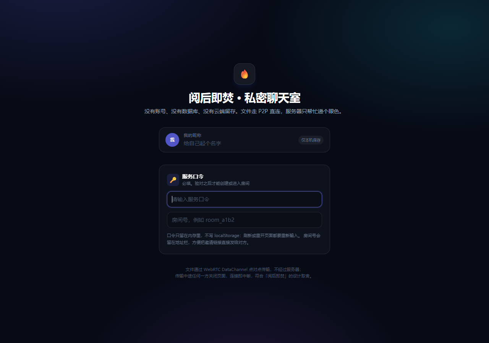
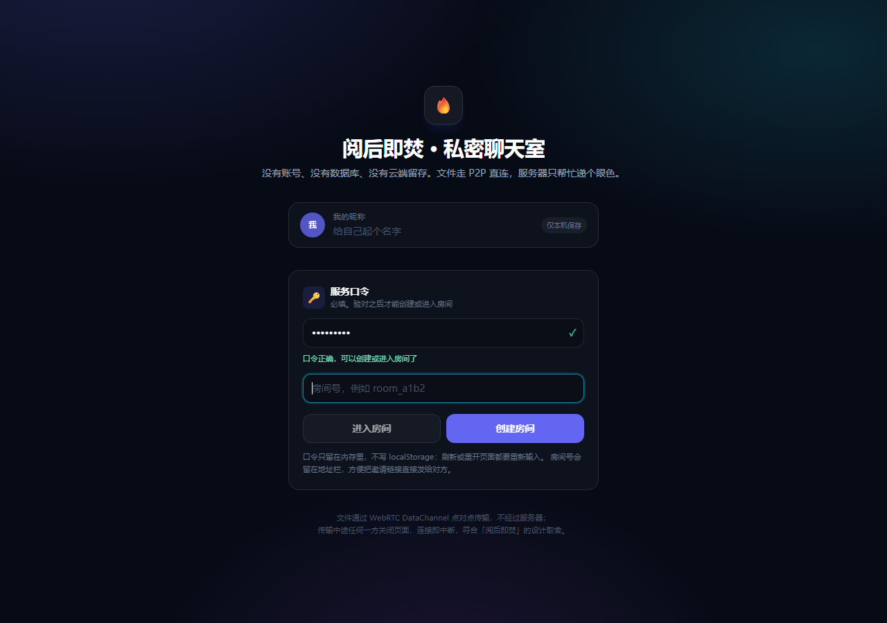
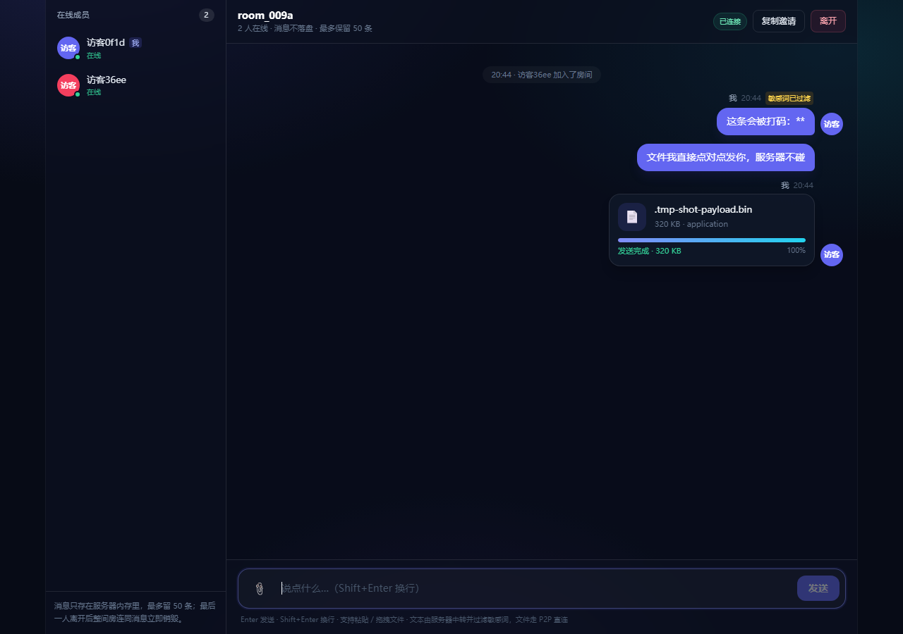

# Ghost Drop · 阅后即焚的 P2P 私密聊天室

一个**没有数据库、没有磁盘、没有服务器端文件**的私密聊天室：
文本走 WebSocket 由服务器中转，文件走 WebRTC DataChannel 点对点直传，
最后一个人离开时房间连同全部消息立即销毁。

```
浏览器 A ──┐                        ┌── 浏览器 B
           ├─ Socket.io（文本 / 信令）┤
           │        server.js       │
           └────────────────────────┘
           └──── WebRTC DataChannel（文件本体，16KB 分片）────┘
```

## 特性

| 能力 | 实现 |
| --- | --- |
| 服务口令（准入门槛） | 全站唯一暗号，**不输对就用不了服务**：没有口令连房间都创建不了。来源：`ACCESS_CODE` 环境变量 → `access-code.txt` → 随机生成（打印在启动日志） |
| 口令校验 | 前端先 `access:verify` 验对，服务端再在 `room:create` / `room:join` 里二次校验；常量时间比较，连续错 6 次锁 60 秒 |
| 无持久化 | 房间、成员、最近 50 条消息只存在于 Node 进程内存中，进程重启即归零；口令只留在页面内存，刷新要重新输入 |
| 阅后即焚 | 房间最后一个连接断开 → 立即 `delete` 房间对象（消息随房间一起回收） |
| 进入方式 | 首页输口令 → 出现「进入房间 / 创建房间」两个按钮；带 `?room=` 的邀请链接会自动把房间号带进来 |
| 身份缓存 | `localStorage` 只保存 `userId` 与昵称，刷新不丢 |
| 文本流 | 服务器中转，每房间保留最新 50 条，新成员随加入响应一次性拉取 |
| 敏感词过滤 | 广播前用 `badWords` 列表替换为 `*`，命中时消息带 `filtered` 标记 |
| 文件 P2P | 只广播卡片元数据；接收方点「下载」后双方经信令建立 DataChannel，16KB 分片传输 |
| 网络提示 | 监听 `iceConnectionState`，`failed` / `disconnected` 时在卡片和顶部状态栏明确提示 |
| 传输自愈 | DataChannel 心跳 + 5 秒无进展自动 `restartIce()`，最多 3 次 |
| 在线成员 | 右侧（移动端为抽屉）实时显示房间成员 |
| 反滥用 | 发言 / 建卡 / 信令 / 建房 / 口令校验的滑动窗口限流，房间数与人数上限 |

## 目录

```
server.js           后端：Express + Socket.io，内存房间表 + 信令中继
index.html          前端：UI + 业务逻辑 + WebRTC（Tailwind CDN，无构建）
package.json        依赖：express、socket.io
Dockerfile          node:20-alpine 镜像，非 root 运行，自带 HEALTHCHECK
compose.yaml        一键部署，映射 127.0.0.1:3001 -> 容器 3000
nginx.conf.example  反向代理示例（重点：WebSocket Upgrade 三件套）
```

## 一键部署（Docker）

**第 0 步：定一个服务口令。** 三种方式任选其一，优先级从高到低：

```bash
export ACCESS_CODE='换成你自己的口令'                 # 1. 环境变量（推荐）
echo '换成你自己的口令' > access-code.txt              # 2. 文件（配合下面的 volumes 挂载）
# 3. 都不做：容器启动时随机生成一个，用 docker compose logs 查看
```

```bash
docker compose up -d --build      # 首次构建约 1 分钟
docker compose ps                 # 状态应为 healthy
docker compose logs | head -20    # 看 [gate] 那几行：口令从哪里来的 / 随机口令是什么
open http://127.0.0.1:3001        # macOS 用 open，Linux 用 xdg-open
```

打开首页 → 输入上一步的口令 → 出现「进入房间 / 创建房间」→ 开始用。

国内网络如果拉包慢：

```bash
NPM_REGISTRY=https://registry.npmmirror.com docker compose up -d --build
```

常用命令：

```bash
docker compose logs -f            # 只有生命周期日志，聊天内容不会落盘
docker compose down               # 停止并删除容器（房间数据随之消失）
```

## 本地开发（不用 Docker）

```bash
npm install
ACCESS_CODE='你的口令' npm start   # 默认 http://127.0.0.1:3000
# Windows PowerShell：
#   $env:ACCESS_CODE='你的口令'; node server.js
# 或把口令写进 ./access-code.txt（首行非空内容），server.js 会自动读
```

`package.json` 里 `npm run dev` 使用 `node --watch`，改代码自动重启。

## 进入流程（口令闸门）

1. **必须验口令**：首页只有一个「服务口令」输入框。输入正确口令后，
   下方才出现「进入房间」和「创建房间」两个按钮 —— 没验对之前服务不可用
   （服务端在创建/加入时还会再校验一次，绕过前端也没用）。
2. **创建房间**：点「创建房间」→ 前端生成 `room_a1b2` 形式的房间号 →
   后端注册 → 地址栏变成 `?room=room_a1b2`。房间号撞车会自动重试新的随机号。
3. **进入房间**：带 `?room=room_a1b2` 的链接会把房间号自动填好（只显示成标签，
   不用手打）；没有参数时可以自己输入房间号。房间已经因为人走光而焚毁时，
   会问你「重建并进入」还是「算了」。
4. **打开邀请链接**：对方同样要先输口令，然后点「进入房间」。

> 房间号会被规范化：`A1B2!`、`room_A1B2` 都会变成 `room_a1b2`。
> 口令只存在页面内存（`state.accessCode`），刷新、重开标签页都要重新输入。

## 外网部署（Nginx）

`compose.yaml` 只把端口映射到 `127.0.0.1:3001`，外网访问统一交给 Nginx：

```bash
sudo cp nginx.conf.example /etc/nginx/conf.d/burn-chat.conf
sudo nginx -t && sudo nginx -s reload
```

WebSocket 必须透传这三个头，否则会退化成轮询或握手 400：

```nginx
proxy_http_version 1.1;
proxy_set_header Upgrade    $http_upgrade;
proxy_set_header Connection $connection_upgrade;   # map: upgrade / close
proxy_read_timeout 3600s;                          # 别让 60s 默认值掐断长连接
```

## 关于 P2P 与 STUN

`iceServers` 依次配置了：

1. 自建 `stun:piik.siyin.fun:3478`
2. `stun:stun.l.google.com:19302`
3. `stun:stun1.l.google.com:19302`

只配了 STUN（没有 TURN），所以**对称型 NAT / 严格企业防火墙下可能打不通**，
此时卡片会提示「网络环境严格，P2P 连接失败」。需要更高成功率时，
按下面的形状加一台 TURN（coturn）：

```js
{ urls: 'turn:your-turn-host:3478', username: '...', credential: '...' }
```

STUN/TURN 走 UDP，和 Nginx 无关，需要在防火墙放行对应端口。

## 已知边界

- **口令是单一的**：全站共用一个，改了要重启服务（或重新挂载 `access-code.txt`），
  且不会区分用户 —— 它只是一道门，不是账号体系。
- **单进程内存**：不支持多副本水平扩展（多实例之间房间不共享）。要横向扩展需接
  Socket.io Redis adapter 并额外解决信令路由。
- **文件上限 1GB**：接收端要在浏览器内存里拼装 Blob，超过这个量级容易 OOM。
- **同一浏览器多标签**：共用 `localStorage` 里的 `userId`，会被识别为同一用户。
- **刷新即重连**：刷新会短暂断开，而且口令要重输；如果你是最后一人，房间已被焚毁，
  重新进入后会按原房间号自动重建一个空房间（历史消息不可恢复）。
- **敏感词表**是极简示例，真实场景应换成可热更新的词库。

## 界面

| 口令闸门（还没验对） | 验对后出现两个按钮 |
| --- | --- |
|  |  |

| 聊天 + P2P 文件卡片 | 手机端 |
| --- | --- |
|  |  |

## 安全说明

- **口令不落盘**：只在 Node 进程内存里，用 `crypto.timingSafeEqual` 做常量时间比较；
  不进镜像（`.dockerignore` 已排除 `access-code.txt` 与 `.env`），不进浏览器存储。
- 口令错误按连接累计，连续 6 次锁 60 秒；口令校验本身也有限流。
- 房间号不是凭证，**口令才是**：拿到链接的人仍然需要口令才能进。
- 页面无 CSP（Tailwind CDN 需要内联样式），生产环境建议自行收敛，
  或把 Tailwind 预编译成静态 CSS 后启用严格 CSP。
- 所有聊天内容只在内存中，Docker 日志仅有房间生命周期事件与口令来源。

## 许可证

[MIT](LICENSE) © 2026 siyin67
