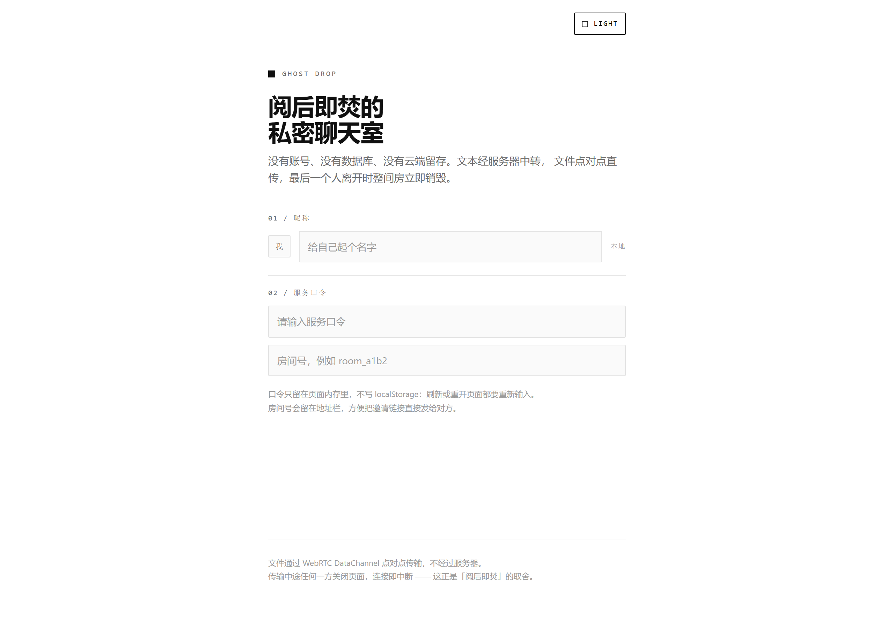
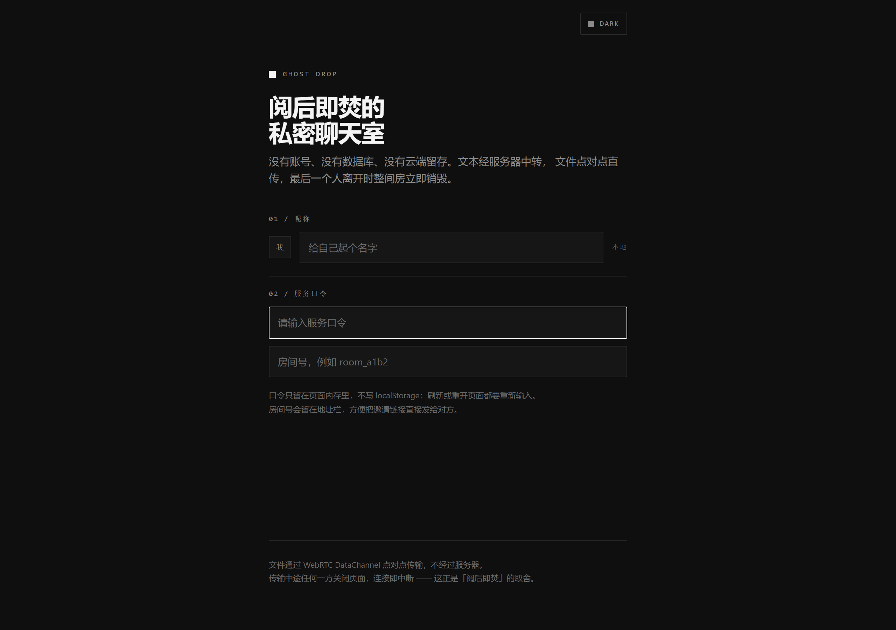
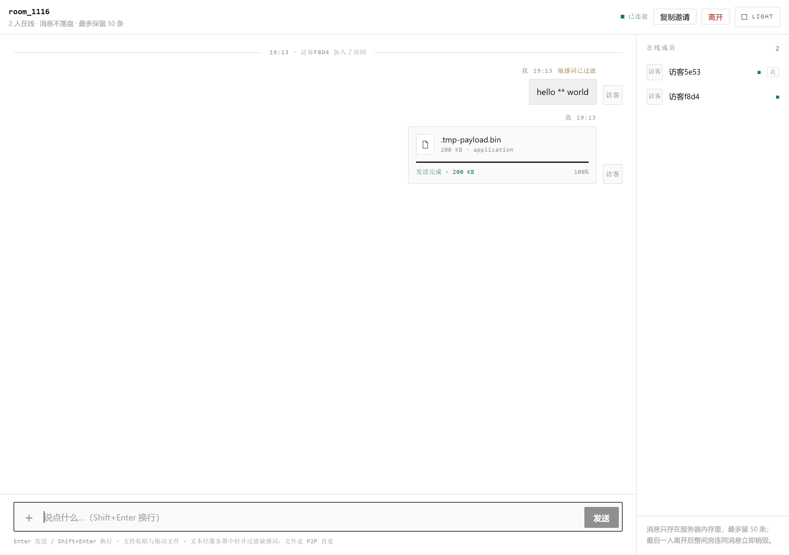
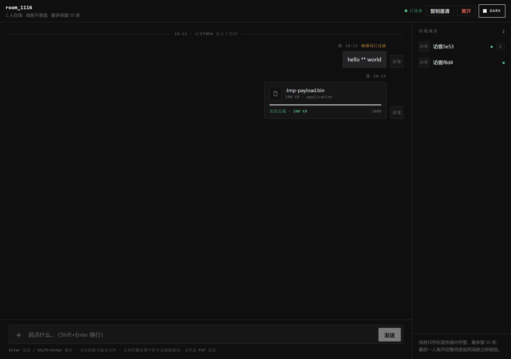
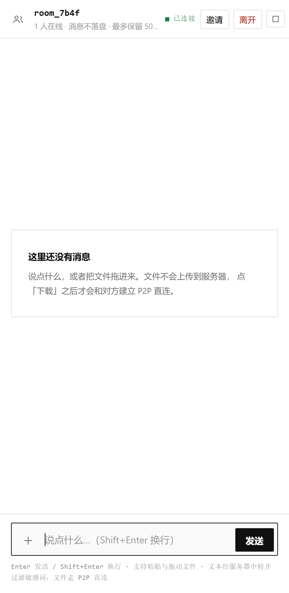
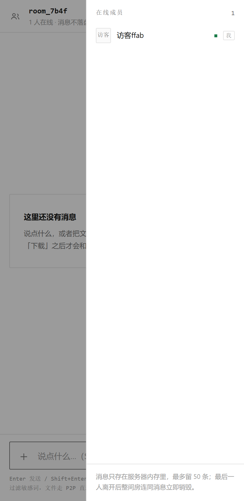

# Ghost Drop · 阅后即焚的 P2P 私密聊天室

一个**没有数据库、没有磁盘、没有服务器端文件**的私密聊天室：
文本走 WebSocket 由服务器中转，文件走 WebRTC DataChannel 点对点直传，
最后一个人离开时房间连同全部消息立即销毁。

```
浏览器 A ──┐                        ┌── 浏览器 B
           ├─ Socket.io（文本 / 信令）┤
           │        server.js       │
           └────────────────────────┘
           └──── WebRTC DataChannel（文件本体，16KB 分片）────┘
```

界面是瑞士国际主义式的极简排版：纯白 / 深空灰两套主题、1px 实线、没有任何
Emoji 与渐变、没有前端框架与 CDN —— 一个 `index.html` 里同时放着 CSS 和原生 JS。

## 特性

| 能力 | 实现 |
| --- | --- |
| 服务口令（准入门槛） | 全站唯一暗号，**不输对就用不了服务**：没有口令连房间都创建不了。来源：`ACCESS_CODE` 环境变量 → `access-code.txt` → 随机生成（打印在启动日志） |
| 口令校验 | 前端先 `access:verify` 验对，服务端再在 `room:create` / `room:join` 里二次校验；常量时间比较，连续错 6 次锁 60 秒 |
| 无持久化 | 房间、成员、最近 50 条消息只存在于 Node 进程内存中，进程重启即归零；口令只留在页面内存，刷新要重新输入 |
| 阅后即焚 | 房间最后一个连接断开 → 立即 `delete` 房间对象（消息随房间一起回收） |
| 进入方式 | 首页输口令 → 出现「进入房间 / 创建房间」两个按钮；带 `?room=` 的邀请链接会自动把房间号带进来 |
| 身份缓存 | `localStorage` 只保存 `userId`、昵称与主题偏好，刷新不丢 |
| 双主题 | `:root` 与 `[data-theme="dark"]` 两套 CSS 变量，右上角一个几何按钮切换，`localStorage` 记住选择 |
| 文本流 | 服务器中转，每房间保留最新 50 条，新成员随加入响应一次性拉取 |
| 敏感词过滤 | 广播前用 `badWords` 列表替换为 `*`，命中时消息带 `filtered` 标记 |
| 文件 P2P | 只广播卡片元数据；接收方点「下载」后双方经信令建立 DataChannel，16KB 分片传输 |
| 拖拽发送 | 文件拖到窗口任意位置 → 整页虚线覆盖层「释放以发送文件」 |
| STUN 可配置 | 后端从 `STUN_URLS` 读，通过 `GET /api/config` 下发；前端启动时 fetch 后动态构建 `iceServers`，代码里没有写死任何 STUN |
| 网络提示 | 监听 `iceConnectionState`，`failed` / `disconnected` 时在卡片和顶部状态栏明确提示 |
| 传输自愈 | DataChannel 心跳 + 12 秒无进展自动 `restartIce()`，最多 2 次 |
| 在线成员 | 右侧（移动端为抽屉）实时显示房间成员 |
| 反滥用 | 发言 / 建卡 / 信令 / 建房 / 口令校验的滑动窗口限流，房间数与人数上限 |

## 目录

```
server.js           后端：Express + Socket.io，内存房间表 + 信令中继 + /api/config
index.html          前端：极简双主题 UI + 业务逻辑 + WebRTC（零依赖、零构建）
package.json        依赖：express、socket.io、dotenv
Dockerfile          node:20-alpine 镜像，非 root 运行，自带 HEALTHCHECK
compose.yaml        一键部署，映射 127.0.0.1:3001 -> 容器 3000，注入口令与 STUN
.env.example        环境变量模板（拷成 .env 再改）
nginx.conf.example  反向代理示例（重点：WebSocket Upgrade 三件套）
```

## 一键部署（Docker）

```bash
cp .env.example .env                                  # Windows: Copy-Item .env.example .env
# 编辑 .env：至少把 ACCESS_CODE 换成你自己的口令
docker compose up -d --build                          # 首次构建约 1 分钟
docker compose ps                                     # 状态应为 healthy
docker compose logs | head -20                        # 看 [boot] 那几行：口令来源、下发的 STUN
open http://127.0.0.1:3001                            # macOS open / Linux xdg-open
```

`.env` 里两个变量：

```dotenv
ACCESS_CODE=换成你自己的口令
STUN_URLS=stun:stun.l.google.com:19302
```

`STUN_URLS` 用逗号分隔，可以写多个（最多 8 个，非 `stun:` / `stuns:` / `turn:` / `turns:`
的条目会被静默丢弃）：

```dotenv
STUN_URLS=stun:piik.siyin.fun:3478,stun:stun.l.google.com:19302,stun:stun1.l.google.com:19302
```

不想用 `.env` 也可以直接走环境变量：

```bash
ACCESS_CODE='你的口令' STUN_URLS='stun:stun.l.google.com:19302' docker compose up -d --build
# 口令也可以用文件：echo '你的口令' > access-code.txt，并在 compose.yaml 里放开 volumes 挂载
```

国内网络如果拉包慢：

```bash
NPM_REGISTRY=https://registry.npmmirror.com docker compose up -d --build
```

常用命令：

```bash
docker compose logs -f            # 只有生命周期日志，聊天内容不会落盘
docker compose down               # 停止并删除容器（房间数据随之消失）
```

> 改了 `STUN_URLS` 或 `ACCESS_CODE` 就要 `docker compose up -d` 重建容器才生效 ——
> 它们只在进程启动时读一次。

## 本地开发（不用 Docker）

```bash
npm install
cp .env.example .env              # 然后改 .env 里的 ACCESS_CODE
npm start                         # 默认 http://127.0.0.1:3000
# Windows PowerShell 临时变量：
#   $env:ACCESS_CODE='你的口令'; $env:STUN_URLS='stun:stun.l.google.com:19302'; node server.js
```

`server.js` 启动时会读同目录的 `.env`（`dotenv`，文件不存在就跳过），
所以本地开发也不用手抄环境变量。`npm run dev` 使用 `node --watch`，改代码自动重启。

## HTTP 接口

| 方法 | 路径 | 说明 |
| --- | --- | --- |
| GET | `/` | 前端页面（`Cache-Control: no-store`） |
| GET | `/healthz` | 健康检查：`{"ok":true,"uptime":N,"rooms":N}` |
| GET | `/api/config` | 下发给前端的运行配置：`{"stunUrls":["stun:..."]}` |

`/api/config` 的意义：STUN 地址属于部署期配置，写在前端就等于每次换服务器都要改代码。
前端在 `boot()` 里 `fetch('/api/config')` 拿到列表后才构建 `iceServers`，
所以同一份静态文件可以部署到任意环境。

## 进入流程（口令闸门）

1. **必须验口令**：首页只有一个「服务口令」输入框。输入正确口令后，
   下方才出现「进入房间」和「创建房间」两个按钮 —— 没验对之前服务不可用
   （服务端在创建/加入时还会再校验一次，绕过前端也没用）。
2. **创建房间**：点「创建房间」→ 前端生成 `room_a1b2` 形式的房间号 →
   后端注册 → 地址栏变成 `?room=room_a1b2`。房间号撞车会自动重试新的随机号。
3. **进入房间**：带 `?room=room_a1b2` 的链接会把房间号自动填好（只显示成标签，
   不用手打）；没有参数时可以自己输入房间号。房间已经因为人走光而焚毁时，
   会问你「重建并进入」还是「算了」。
4. **打开邀请链接**：对方同样要先输口令，然后点「进入房间」。

> 房间号会被规范化：`A1B2!`、`room_A1B2` 都会变成 `room_a1b2`。
> 口令只存在页面内存（`state.accessCode`），刷新、重开标签页都要重新输入。

## 外观与主题

- **两套颜色**：`:root` 是白天（`#fff` 底 / `#101010` 字 / `#e3e3e3` 线），
  `[data-theme="dark"]` 是黑夜（`#101010` 底 / `#f4f4f4` 字 / `#2a2a2c` 线）。
  想换配色只改这两块变量，不用翻样式。
- **切换按钮**：右上角一个几何方块 —— 白天空心、黑夜实心，旁边写着 `LIGHT` / `DARK`。
  手机宽度下只留方块（`aria-label` 仍在）。偏好写进 `localStorage['ghostdrop:theme']`，
  并在 `<head>` 里用一段内联脚本先套上，避免刷新时白屏闪一下。
- **没有 Emoji**：图标全是内联 SVG 路径或纯 CSS 画的方块/对勾/叉号；
  文件类型、在线状态、进度都用几何形状表示。
- **排版**：`--sans` 系统无衬线 + `--mono` 等宽，标签一律小号大写字距排版；
  边框一律 1px 实线，阴影几乎不可见；断点 1023px 以下成员栏收进抽屉。

## 外网部署（Nginx）

`compose.yaml` 只把端口映射到 `127.0.0.1:3001`，外网访问统一交给 Nginx：

```bash
sudo cp nginx.conf.example /etc/nginx/conf.d/burn-chat.conf
sudo nginx -t && sudo nginx -s reload
```

WebSocket 必须透传这三个头，否则会退化成轮询或握手 400：

```nginx
proxy_http_version 1.1;
proxy_set_header Upgrade    $http_upgrade;
proxy_set_header Connection $connection_upgrade;   # map: upgrade / close
proxy_read_timeout 3600s;                          # 别让 60s 默认值掐断长连接
```

## 关于 P2P 与 STUN

前端不再写死 STUN：页面加载时 `GET /api/config` → 拿到 `stunUrls` 数组 →
`new RTCPeerConnection({ iceServers: stunUrls.map(urls => ({ urls })) })`。
默认值是 `stun:stun.l.google.com:19302`，你可以在 `.env` 的 `STUN_URLS` 里换成自建地址。

只配了 STUN（没有 TURN），所以**对称型 NAT / 严格企业防火墙下可能打不通**，
此时卡片会提示「网络环境严格，P2P 连接失败」。需要更高成功率时，
除了把 TURN 地址写进 `STUN_URLS`，还要带上凭据 —— 那种情况建议扩展
`/api/config` 的返回结构（例如 `iceServers` 直接返回带 `username` / `credential` 的对象），
并且**给这个接口加鉴权**，否则长期凭据会随页面发给任何人：

```js
{ urls: 'turn:your-turn-host:3478', username: '...', credential: '...' }
```

STUN/TURN 走 UDP，和 Nginx 无关，需要在防火墙放行对应端口。

## 已知边界

- **口令是单一的**：全站共用一个，改了要重启服务（或重新挂载 `access-code.txt`），
  且不会区分用户 —— 它只是一道门，不是账号体系。
- **STUN 列表是启动期配置**：改了要重启容器；已经打开的页面也不会自动换 ICE 服务器
  （刷新才重新 fetch `/api/config`）。
- **单进程内存**：不支持多副本水平扩展（多实例之间房间不共享）。要横向扩展需接
  Socket.io Redis adapter 并额外解决信令路由。
- **文件上限 1GB**：接收端要在浏览器内存里拼装 Blob，超过这个量级容易 OOM。
- **同一浏览器多标签**：共用 `localStorage` 里的 `userId`，会被识别为同一用户。
- **刷新即重连**：刷新会短暂断开，而且口令要重输；如果你是最后一人，房间已被焚毁，
  重新进入后会按原房间号自动重建一个空房间（历史消息不可恢复）。
- **敏感词表**是极简示例，真实场景应换成可热更新的词库。

## 界面

| 白天 | 黑夜 |
| --- | --- |
|  |  |

| 聊天 + P2P 文件卡片（白天） | 聊天 + P2P 文件卡片（黑夜） |
| --- | --- |
|  |  |

| 手机端 | 手机端成员抽屉 |
| --- | --- |
|  |  |

## 安全说明

- **口令不落盘**：只在 Node 进程内存里，用 `crypto.timingSafeEqual` 做常量时间比较；
  不进镜像（`.dockerignore` 已排除 `access-code.txt` 与 `.env`），不进浏览器存储。
- 口令错误按连接累计，连续 6 次锁 60 秒；口令校验本身也有限流。
- 房间号不是凭证，**口令才是**：拿到链接的人仍然需要口令才能进。
- 页面**不引用任何外部资源**（无 CDN、无外链字体），所以很容易加严格 CSP，
  例如 `default-src 'self'; style-src 'self' 'unsafe-inline'; img-src 'self' data: blob:`。
- 所有聊天内容只在内存中，Docker 日志仅有房间生命周期事件与口令来源。

## 许可证

[MIT](LICENSE) © 2026 siyin67
